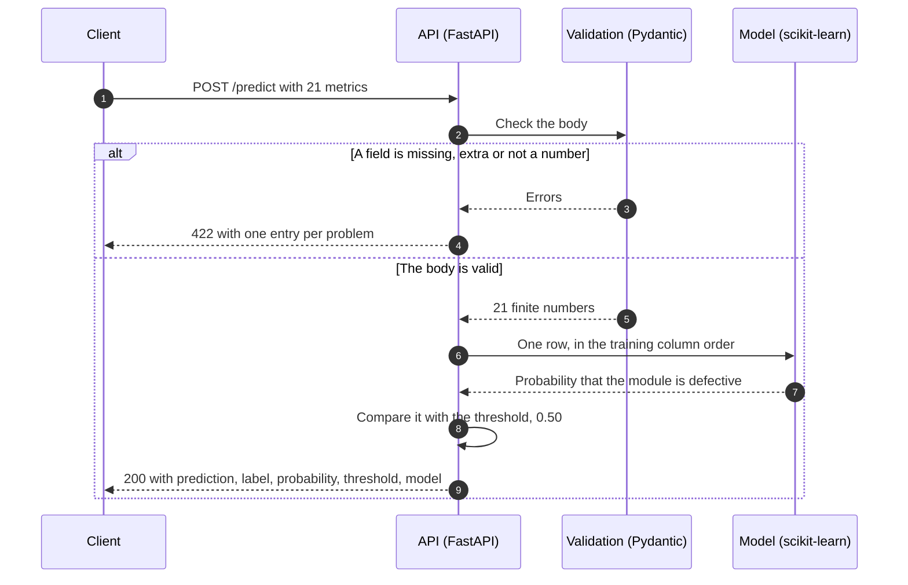

# KC1 prediction API reference

The KC1 API serves the project's defect-prediction model over HTTP. Send the 21 static code metrics of one software module, and it returns whether the model flags the module as defective, with the probability and the threshold behind the decision.

FastAPI's test client recorded every request and response on this page on 19 November 2026, against the model that the project's own trainer produced. The test client calls the application in the same process, so the recording needed no server and no port. The trained model reproduces the [model card](/docs/kc1/model-card): logistic regression with balanced class weights, a threshold of 0.50, and F1 0.500 on the 243 test modules.

## At a glance

| Item | Value |
|---|---|
| Base URL | `http://127.0.0.1:8000`, when you start the API with the project's Docker Compose file. The Compose file publishes the port on this computer only. |
| API version | 1.0.1 |
| Format | JSON in and JSON out. Send `Content-Type: application/json`. |
| Authentication | None. The API has no sign-in and no keys. Keep it on `127.0.0.1`, as the Compose file does, or put an authenticating gateway in front of it. |
| Permissions | None. |
| Rate limits | None. The API doesn't limit requests. |
| Pagination | Doesn't apply. Each call returns one object. |
| Machine-readable description | OpenAPI 3.1, served by the API at `/openapi.json`, with Swagger UI at `/docs` and ReDoc at `/redoc`. |

[Download the OpenAPI description as the API serves it](/docs/kc1/api/openapi.json), or [every recorded request and response](/docs/kc1/api/exchanges.json).

## Endpoints

| Method | Path | What it does |
|---|---|---|
| `GET` | `/` | Names the API and the model it serves. |
| `GET` | `/health` | Says whether the API has loaded the model, with its name, its threshold, and the number of features it expects. |
| `POST` | `/predict` | Predicts whether one module is defective. |

None of the endpoints takes a path parameter or a query parameter.

## GET /health

Check that the API is up and has loaded the model, before you send predictions.

```bash
curl http://127.0.0.1:8000/health
```

The API answers `200 OK`.

```json
{
  "status": "ok",
  "model_loaded": true,
  "model": "Logistic balanced",
  "threshold": 0.5,
  "feature_count": 21
}
```

| Field | Type | Meaning |
|---|---|---|
| `status` | string | `ok` whenever the API answers. |
| `model_loaded` | boolean | `true` when the model loaded at startup. The API doesn't start without a model, so it's always `true` in practice. |
| `model` | string | The name of the candidate the trainer selected. |
| `threshold` | number | The probability at and above which a module is called defective. |
| `feature_count` | integer | The number of metrics `/predict` expects: 21. |

`GET /` returns a shorter form of the same: `{"message": "Group 6 KC1 Software Defect Prediction API", "model": "Logistic balanced"}`.

## POST /predict

Send the metrics of one module. The API answers with one prediction.

### Request body

A JSON object with exactly these 21 fields, each a finite number. A field that is missing, a field that isn't on the list, and a value that isn't a number are all refused. The definitions follow the PROMISE repository's description of KC1.

| Field | Meaning |
|---|---|
| `loc` | McCabe's count of lines of code |
| `v(g)` | McCabe's cyclomatic complexity |
| `ev(g)` | McCabe's essential complexity |
| `iv(g)` | McCabe's design complexity |
| `n` | Halstead's total of operators and operands |
| `v` | Halstead volume |
| `l` | Halstead program level, about 1 divided by `d` |
| `d` | Halstead difficulty |
| `i` | Halstead intelligence content |
| `e` | Halstead effort |
| `b` | Halstead's estimate of delivered bugs |
| `t` | Halstead's time estimate |
| `lOCode` | Lines of code |
| `lOComment` | Lines of comments |
| `lOBlank` | Blank lines |
| `locCodeAndComment` | Lines with both code and a comment |
| `uniq_Op` | Unique operators |
| `uniq_Opnd` | Unique operands |
| `total_Op` | Total operators |
| `total_Opnd` | Total operands |
| `branchCount` | Branches in the flow graph |

Three names contain parentheses: `v(g)`, `ev(g)` and `iv(g)`. The API also accepts them as `v_g`, `ev_g` and `iv_g`, which suit tools that don't accept parentheses in a name. The recorded responses are the same either way.

### Example

Here are the metrics of a module from the KC1 data set.

```bash
curl -X POST http://127.0.0.1:8000/predict \
  -H "Content-Type: application/json" \
  -d '{"loc": 25, "v(g)": 3, "ev(g)": 1, "iv(g)": 3, "n": 58, "v": 254.75, "l": 0.11, "d": 9.35, "i": 27.25, "e": 2381.95, "b": 0.08, "t": 132.33, "lOCode": 21, "lOComment": 0, "lOBlank": 2, "locCodeAndComment": 0, "uniq_Op": 11, "uniq_Opnd": 10, "total_Op": 41, "total_Opnd": 17, "branchCount": 5}'
```

The API answers `200 OK`.

```json
{
  "prediction": 0,
  "label": "Non-defective",
  "defect_probability": 0.3920490229417669,
  "threshold": 0.5,
  "model": "Logistic balanced"
}
```

### Response

| Field | Type | Meaning |
|---|---|---|
| `prediction` | integer | `1` when the model flags the module as defective, `0` when it doesn't. |
| `label` | string | `Defective` or `Non-defective`, the same decision in words. |
| `defect_probability` | number | The model's probability that the module is defective, from 0 to 1. It is `null` only for a model without probabilities, which the selected model isn't. |
| `threshold` | number | The probability at and above which `prediction` is `1`. |
| `model` | string | The model that made the prediction. |

A flagged module, recorded the same way, comes back as `{"prediction": 1, "label": "Defective", "defect_probability": 0.6756835241062081, "threshold": 0.5, "model": "Logistic balanced"}`.

## Errors

| Status | When | Body |
|---|---|---|
| `422 Unprocessable Content` | A field is missing, a field isn't one of the 21, a value isn't a number or isn't finite, or the body isn't a JSON object. | `detail`: one entry for each problem, with its `type`, its location `loc`, a message `msg` and the `input` that caused it. |
| `404 Not Found` | The path doesn't exist, such as `/predictions`. | `{"detail": "Not Found"}` |
| `405 Method Not Allowed` | The path exists but takes another method, such as `GET /predict`. | `{"detail": "Method Not Allowed"}` |

A request that sends only `loc` gets one entry for each of the 20 missing fields. Here is the first one.

```json
{
  "type": "missing",
  "loc": ["body", "v(g)"],
  "msg": "Field required",
  "input": {"loc": 123}
}
```

## Code examples

Here is the same request in Python, with the `requests` library.

```python
import requests

metrics = {
    "loc": 25, "v(g)": 3, "ev(g)": 1, "iv(g)": 3, "n": 58, "v": 254.75, "l": 0.11,
    "d": 9.35, "i": 27.25, "e": 2381.95, "b": 0.08, "t": 132.33, "lOCode": 21,
    "lOComment": 0, "lOBlank": 2, "locCodeAndComment": 0, "uniq_Op": 11,
    "uniq_Opnd": 10, "total_Op": 41, "total_Opnd": 17, "branchCount": 5,
}
response = requests.post("http://127.0.0.1:8000/predict", json=metrics, timeout=10)
response.raise_for_status()
result = response.json()
print(result["label"], round(result["defect_probability"], 3))
```

Run against the API, with the test client in place of the network, it prints `Non-defective 0.392`. The same request in JavaScript uses `fetch`, in a module or an async function.

```javascript
const response = await fetch("http://127.0.0.1:8000/predict", {
  method: "POST",
  headers: { "Content-Type": "application/json" },
  body: JSON.stringify(metrics),   // the same 21 fields
});
if (!response.ok) throw new Error(`KC1 API: ${response.status}`);
const { label, defect_probability } = await response.json();
```

## How a prediction is made



## Related documents

- [Get your first prediction from the KC1 API](/docs/kc1/api-quickstart), to run the API and call it.
- [Troubleshoot the KC1 API](/docs/kc1/api-troubleshooting), for every error on this page.
- [Model card](/docs/kc1/model-card), for what the model can and can't be used for.
