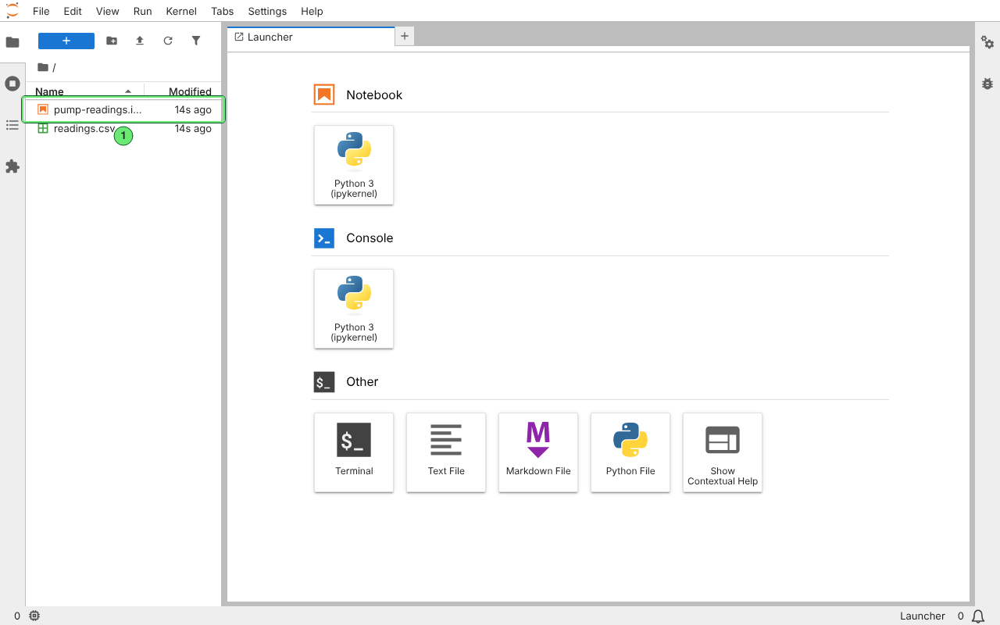
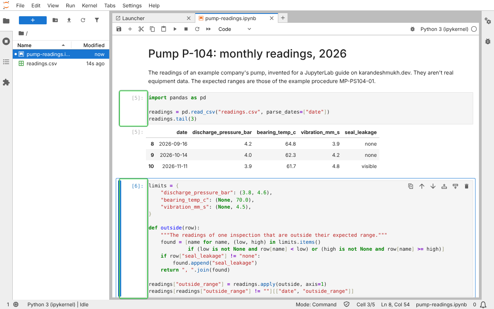
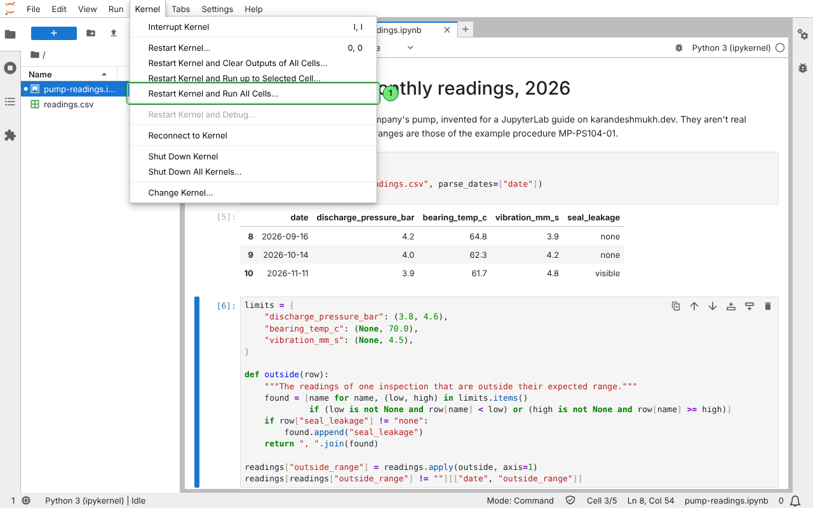
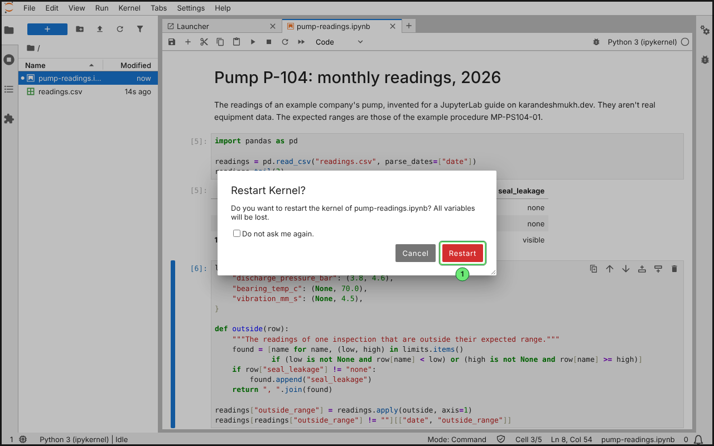
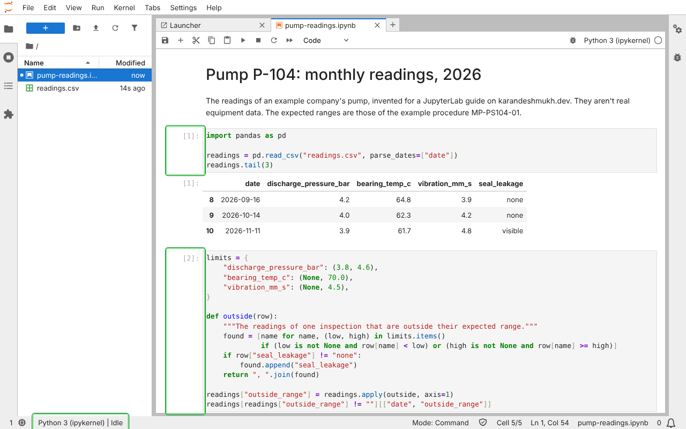
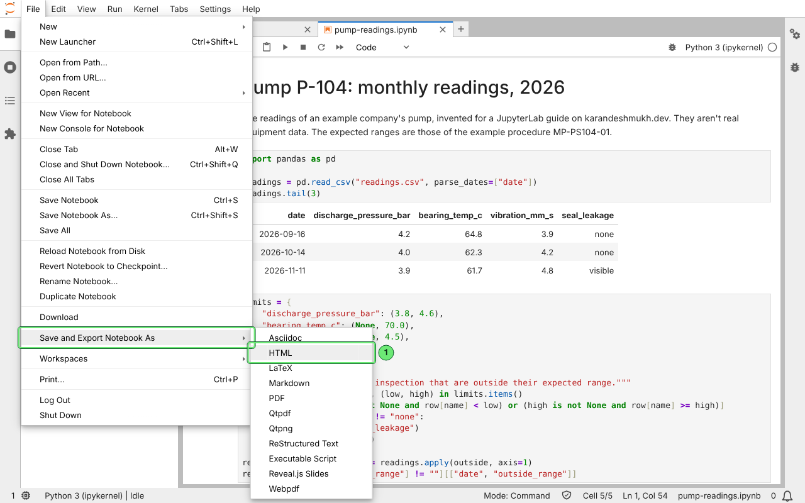
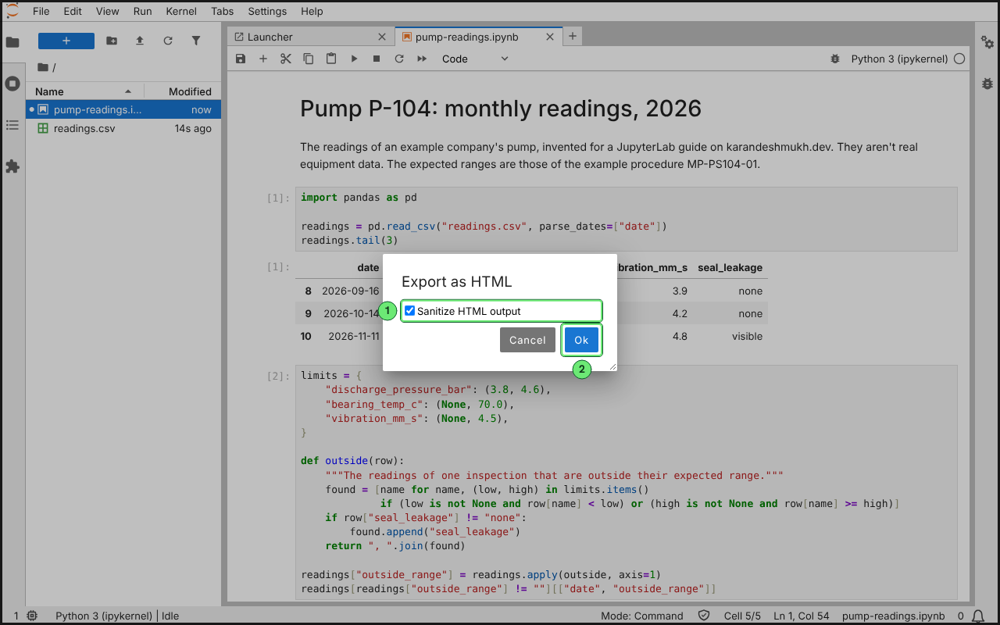
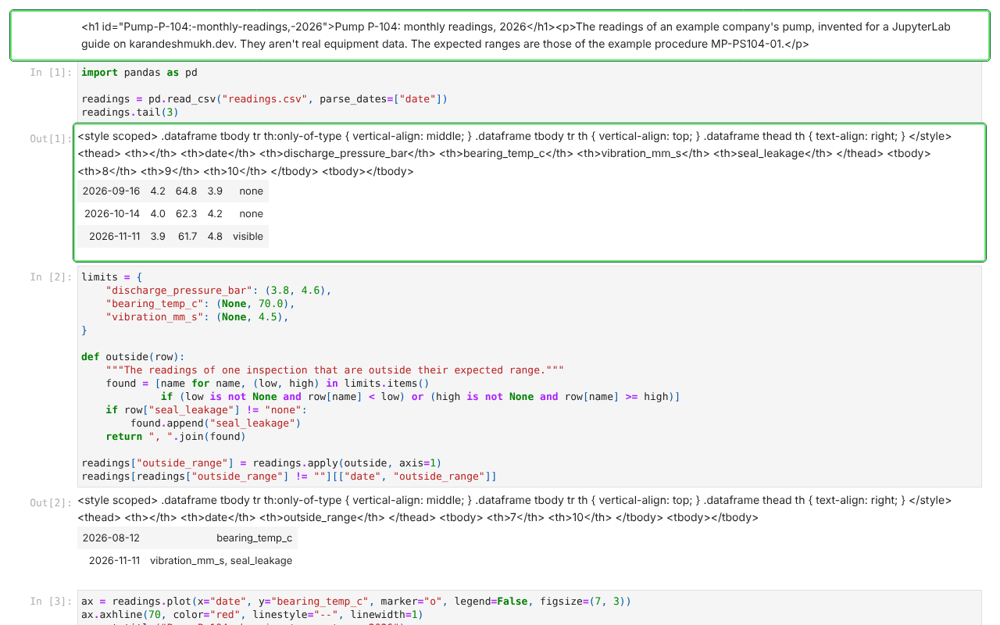

# Run a notebook from a clean start and share it as HTML in JupyterLab

A notebook keeps the output of each cell from the last time that cell ran, in whatever order that was. Before you send the results to someone who doesn't use Jupyter, restart the kernel and run every cell from the top. Then the outputs come from the code as it's written, and the HTML file that you send shows them.

For analysts and anyone who shares the results of a notebook. Written for JupyterLab 4.6.6 and checked against it, with the Python 3 kernel (ipykernel 7.4.0) and nbconvert 7.17.2, on the sample notebook of this guide. This is an independent guide, not official JupyterLab documentation.

## Before you start

- Install JupyterLab 4 and the libraries that the sample uses: `pip install jupyterlab pandas matplotlib`. Then start JupyterLab with `jupyter lab`.
- Put the notebook and the files it reads in the folder that JupyterLab shows. To follow the guide as written, download the sample [pump-readings.ipynb](/docs/jupyterlab/sample/pump-readings.ipynb) and its data, [readings.csv](/docs/jupyterlab/sample/readings.csv): the readings of an example company's pump, invented for this guide.

## Steps

1. In the file browser, double-click **pump-readings.ipynb**.

   

   The number beside a code cell shows when it last ran. Here, the first two code cells show 5 and 6, and the cell under them shows 3. The first two ran again after the cells below them, so their outputs may not match the code read from the top.

   

2. Select **Kernel** > **Restart Kernel and Run All Cells**.

   

3. In **Restart Kernel?**, select **Restart**. The kernel loses every variable, and then JupyterLab runs the cells from the top.

   

4. Wait until the status bar shows **Idle**. Check that the code cells show 1, 2, 3 and 4 from the top, and that no cell shows an error.

   

5. Select **File** > **Save and Export Notebook As** > **HTML**.

   

6. In **Export as HTML**, clear **Sanitize HTML output** if you wrote the notebook or trust everything in it, and then select **Ok**. JupyterLab downloads **pump-readings.html**.

   

## Check that it worked

Open **pump-readings.html** in a browser. It shows the code, the tables and the chart, with the cells numbered from 1, as in the notebook. The last line reads *11 inspections, 2 with a reading outside its range*.

![The exported file in a browser, with the numbers In [1] and In [2] marked](img/jl-08-exported.png)

## When to keep Sanitize HTML output

Sanitizing protects the person who opens the file: nbconvert writes the HTML that it doesn't allow, such as a script in an output, as plain text that can't run. Keep the box selected for a notebook that came from someone else.

It also changes how this notebook looks. With the box selected, the export showed the notebook's heading and the styling of its tables as HTML code.

## If a cell fails after the restart

An error after **Restart Kernel and Run All Cells** usually means that the notebook depended on its earlier session. For example, a cell used a variable from a cell that you deleted, or a cell further down had to run first. Fix the cell, and then restart the kernel and run all the cells again, until every cell runs from the top.

## Next steps

- To share the outputs without the code, export from a terminal: `jupyter nbconvert --to html --no-input pump-readings.ipynb`. The file has the tables and the chart, and no code.
