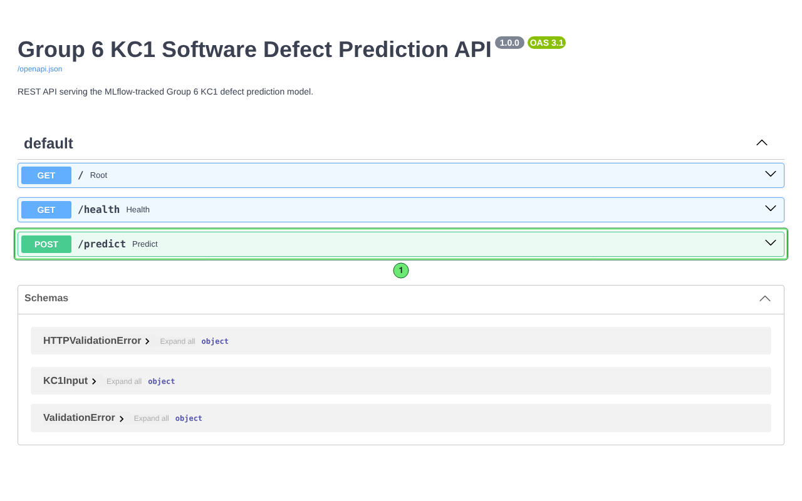
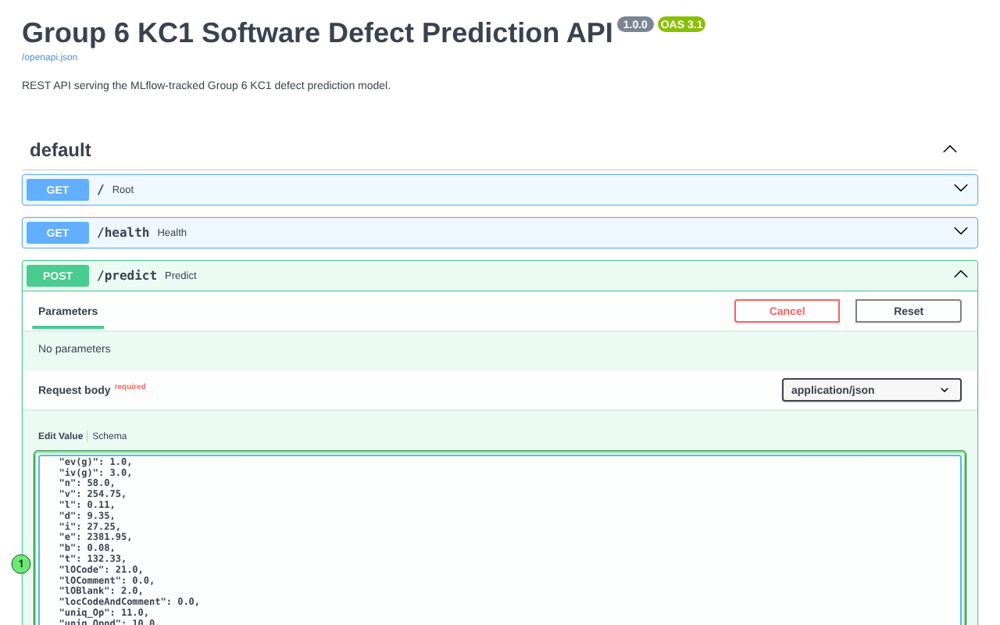
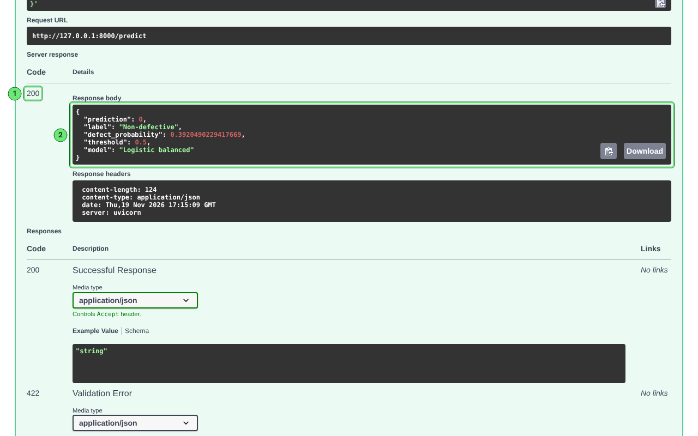

# Get your first prediction from the KC1 API

Train the KC1 model, start the prediction API, and send it the metrics of one software module.

## Before you start

- Docker with Compose version 2. Check with `docker compose version`.
- A copy of the project: `git clone https://github.com/domail2karandeshmukh-cyber/group6-kc1-defect-prediction.git`, then `cd group6-kc1-defect-prediction`.
- Internet access for the first training run, which downloads the KC1 data set.

## Steps

1. Build the image.

   ```bash
   docker compose build
   ```

2. Train the model. The trainer downloads KC1, compares four candidates, and saves the selected model in `artifacts/`.

   ```bash
   docker compose --profile train run --rm trainer
   ```

   The last lines name the model and its threshold: `Selected: Logistic balanced; threshold: 0.50`.

3. Start the API in the background.

   ```bash
   docker compose up -d
   ```

4. Check that the API has loaded the model.

   ```bash
   curl http://127.0.0.1:8000/health
   ```

   The answer includes `"model_loaded": true` and `"feature_count": 21`.

5. Save the metrics of a module in a file named `module.json`.

   ```json
   {"loc": 25, "v(g)": 3, "ev(g)": 1, "iv(g)": 3, "n": 58, "v": 254.75, "l": 0.11, "d": 9.35, "i": 27.25, "e": 2381.95, "b": 0.08, "t": 132.33, "lOCode": 21, "lOComment": 0, "lOBlank": 2, "locCodeAndComment": 0, "uniq_Op": 11, "uniq_Opnd": 10, "total_Op": 41, "total_Opnd": 17, "branchCount": 5}
   ```

6. Send the file to the API.

   ```bash
   curl -X POST http://127.0.0.1:8000/predict -H "Content-Type: application/json" -d @module.json
   ```

## Check that it worked

The API answers with one prediction.

```json
{"prediction": 0, "label": "Non-defective", "defect_probability": 0.3920490229417669, "threshold": 0.5, "model": "Logistic balanced"}
```

These outputs are real. On 19 November 2026, the project's trainer produced the output in step 2. FastAPI's test client recorded the answers in steps 4 and 6 by calling the API in the same process. The Docker commands come from the project's README, and that check didn't include them.

## Try it from the API's own page

The API serves an interactive page at `http://127.0.0.1:8000/docs`, made by Swagger UI from the API's OpenAPI description.

1. Open `http://127.0.0.1:8000/docs`, and select **POST /predict**.

   

2. Select **Try it out**, and paste the contents of `module.json` into the request body.

   

3. Select **Execute**. The page shows the status code, `200`, and the same response as step 6.

   

## Next steps

- Read the [KC1 prediction API reference](/docs/kc1/api-reference) for every field and every error.
- If a request fails, see [Troubleshoot the KC1 API](/docs/kc1/api-troubleshooting).
