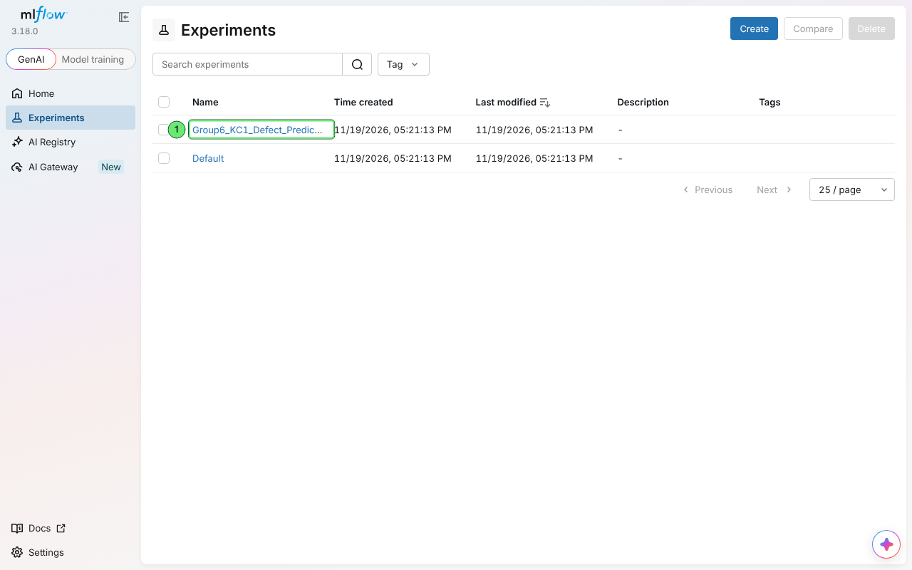
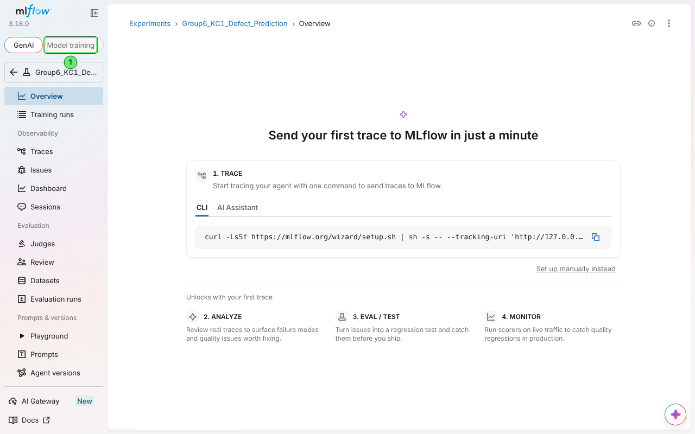
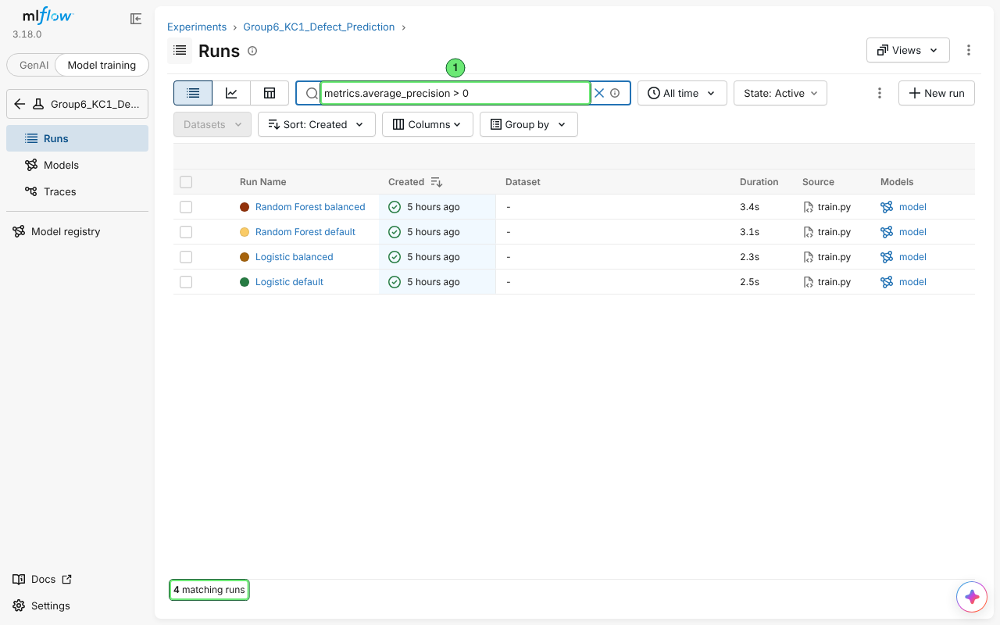
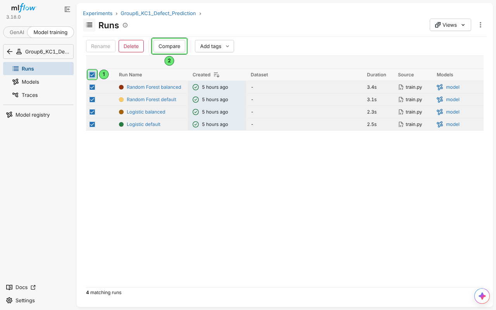
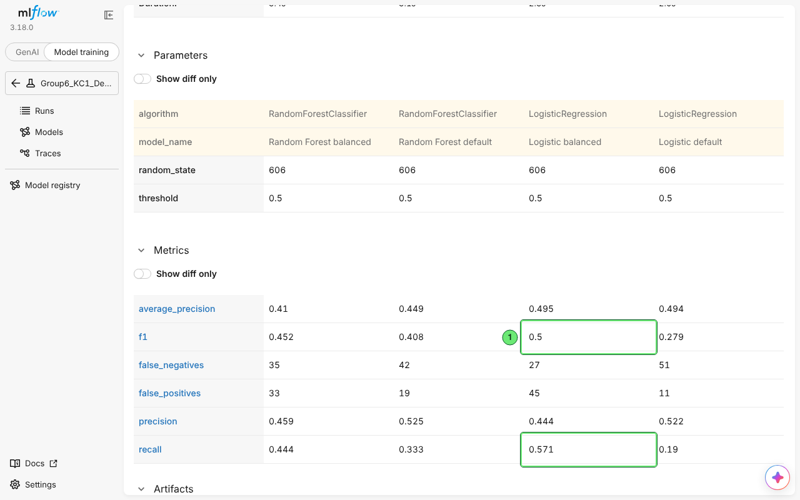

# Compare the KC1 model candidates in MLflow

The KC1 trainer tries four models and keeps one. MLflow, the experiment tracker that runs beside the API, records the results of every candidate, so you can check the choice yourself in a few minutes.

For data scientists and reviewers of the KC1 project. Written for MLflow 3.18.0 and checked against it, on the runs that the project's trainer recorded on 19 November 2026. This is an independent guide, not official MLflow documentation.

## Before you start

- Train the model once, as in [Get your first prediction from the KC1 API](/docs/kc1/api-quickstart). The trainer writes its runs to `artifacts/mlflow.db`.
- Start the project's services with `docker compose up -d`. The `mlflow` service serves the runs at `http://127.0.0.1:5000`.

The screens here come from MLflow 3.18.0, the version that the project's `requirements.txt` installs, started from the command line on the same `artifacts/mlflow.db`. Docker isn't available on the computer I used, so the Compose service itself wasn't run.

## Steps

1. Open `http://127.0.0.1:5000`, select **Experiments**, and then select **Group6_KC1_Defect_Prediction**.

   

2. MLflow 3 opens an experiment in its GenAI view. At the top of the side menu, select **Model training**. The **Runs** table lists the ten runs of the trainer.

   

3. In the search box, type `metrics.average_precision > 0`, and then press Enter. Only the four candidates recorded an average precision, so the table shows **4 matching runs**.

   

4. Select the box at the top of the table to select the four runs, and then select **Compare**.

   

5. Scroll to **Metrics**. Each column is a run, in the order of the table: Random Forest balanced, Random Forest default, Logistic balanced, and Logistic default.

   

## Check the result

The trainer ranks the candidates by recall, then by average precision, because a missed defective module usually costs more than an extra review. Logistic balanced has the highest recall: it finds 36 of the 63 defective modules in the test set. It also has the highest F1. It's the model that the trainer keeps and that the API serves.

| Candidate | Recall | Average precision | F1 | Precision |
|---|---|---|---|---|
| Logistic balanced | 0.571 | 0.495 | 0.500 | 0.444 |
| Random Forest balanced | 0.444 | 0.410 | 0.452 | 0.459 |
| Random Forest default | 0.333 | 0.449 | 0.408 | 0.525 |
| Logistic default | 0.190 | 0.494 | 0.279 | 0.522 |

## Compare the thresholds too

The trainer then tries three thresholds for the model it keeps. To see them, clear the search box, type `params.experiment = 'threshold'`, and then press Enter. The table shows **3 matching runs**. Compare them as in steps 4 and 5:

| Threshold | Recall | Precision | F1 |
|---|---|---|---|
| 0.30 | 0.937 | 0.268 | 0.417 |
| 0.50 | 0.571 | 0.444 | 0.500 |
| 0.70 | 0.222 | 0.538 | 0.315 |

The threshold 0.50 has the best F1, so the API flags a module when its probability is 0.50 or more. Like the comparison of the models, this one uses the test set, so it isn't an independent validation: the [model card](/docs/kc1/model-card) gives the limits.

## Next steps

- The [model card](/docs/kc1/model-card) explains the selection rule and the confusion matrix of the selected model.
- The [API reference](/docs/kc1/api-reference) describes the prediction that the selected model serves.
