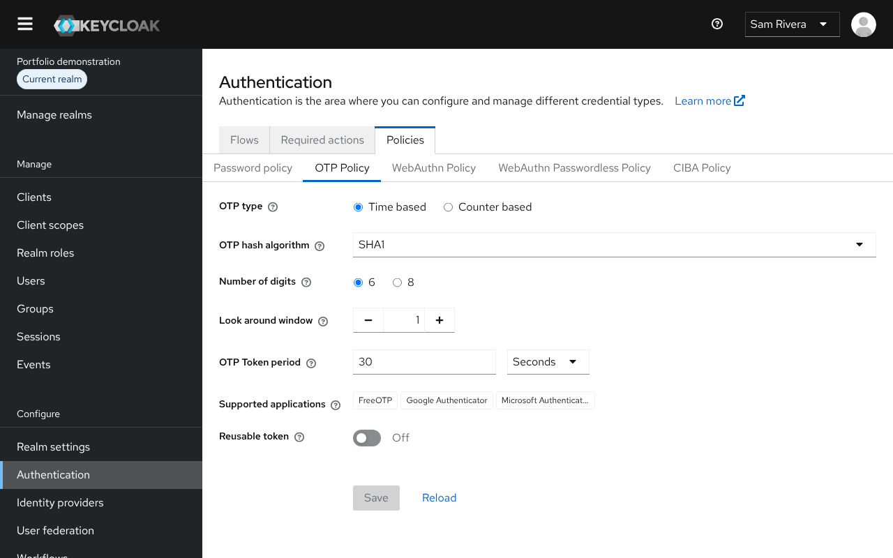

# Keycloak OTP policy: the settings and their defaults

The OTP policy of a realm decides what a one-time password (OTP) looks like in it. It sets how long a code lasts, how many digits it has, and how much clock difference Keycloak forgives. In the admin console, it's under **Authentication** > **Policies** > **OTP Policy**.

The defaults below are those of a new realm in Keycloak 26.8.2, read from the admin console and from the realm's settings in the admin REST API. An independent reference, not official Keycloak documentation.

## Settings

| Setting | Default | What it decides |
|---|---|---|
| **OTP type** | Time based | A time-based code changes every period. A counter-based code changes each time the user asks the app for one. |
| **OTP hash algorithm** | SHA1 | The algorithm the app and Keycloak use to compute a code. The three applications Keycloak names support SHA1. |
| **Number of digits** | 6 | The length of a code: 6 or 8. |
| **Look around window** | 1 | How many periods before and after the current one Keycloak also accepts. With 1, a code of the previous or the next period works, and a code of two periods back doesn't. |
| **OTP Token period** | 30 seconds | How long a time-based code lasts. |
| **Supported applications** | FreeOTP, Google Authenticator, Microsoft Authenticator | The applications that Mobile Authenticator Setup tells users to install. |
| **Reusable token** | Off | Whether a code that has signed someone in can be used again before it expires. |

## The same settings in the admin REST API

Each setting is a field of the realm representation, at `GET /admin/realms/{realm}`.

| Field | Default |
|---|---|
| `otpPolicyType` | `totp` |
| `otpPolicyAlgorithm` | `HmacSHA1` |
| `otpPolicyDigits` | `6` |
| `otpPolicyLookAheadWindow` | `1` |
| `otpPolicyPeriod` | `30` |
| `otpPolicyCodeReusable` | `false` |
| `otpPolicyInitialCounter` | `0`, used only by counter-based codes |

## Before you change a setting

A change applies only to authenticators set up after it. Each OTP credential keeps the type, the digits, the period, and the algorithm it was set up with. When I changed a realm from 6 to 8 digits, a phone set up before the change still signed in with its 6-digit codes. To move every user to the new policy, reset each user's authenticator: [Reset a user's OTP credential in Keycloak](/docs/keycloak/reset-otp).
