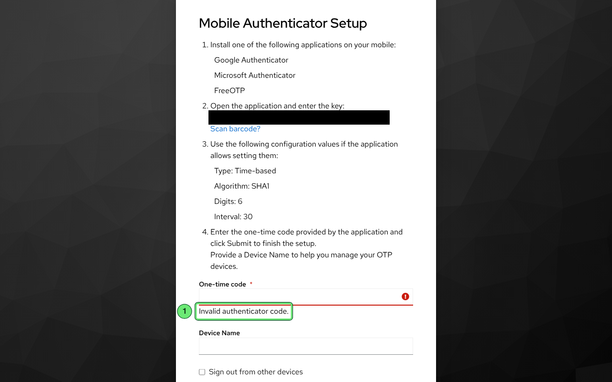
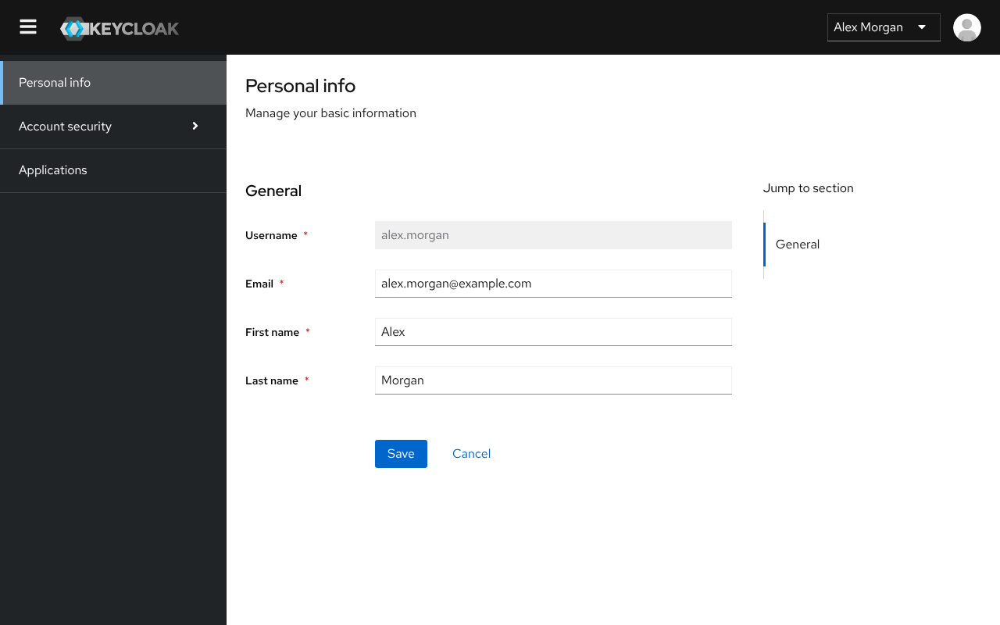

# When a Keycloak user can't sign in with a one-time password

What a user sees when their one-time password (OTP) doesn't work in Keycloak 26.8.2, why it happens, and what an administrator does about it. I reproduced every cause here on a Keycloak 26.8.2 server running on my own computer. An independent guide, not official Keycloak documentation.

## Symptoms

- The user types the code from their authenticator app, and Keycloak answers *Invalid authenticator code.*
- The user has lost the phone with the authenticator, so they have no code to type.
- After an administrator deleted the user's authenticator, the user signs in with the password alone, and Keycloak never asks for a code.

## The code arrives too late, or the phone's clock is wrong

A code is valid for one period of the realm's OTP policy: 30 seconds by default. With the default look around window of 1, Keycloak also accepts the code of the period before and the period after. Keycloak refuses a code from two periods back with *Invalid authenticator code.*

1. Ask the user to type the code that the app shows now, before the timer in the app runs out.
2. If every code fails, ask the user to set the phone's date and time to update automatically. An authenticator computes each code from the time, so a phone that is a minute off produces codes Keycloak refuses.
3. If the clocks of many users drift, check the server's clock before you widen the look around window in the [OTP policy](/docs/keycloak/otp-policy). A wider window accepts older codes, for everyone.

## The user lost the phone

The authenticator went with the phone, and Keycloak keeps no copy within the user's reach. Sign the user out, require a new authenticator, and delete the lost phone's OTP credential: [Reset a user's OTP credential in Keycloak](/docs/keycloak/reset-otp).

## Keycloak no longer asks for a code

An administrator deleted the user's OTP credential, and nothing asked the user to set up a new one. Keycloak's default sign-in flow runs its second-factor step only for a user who has a second factor configured, so a user without one signs in with the password alone.

On the user's **Details** tab, add **Configure OTP** to **Required user actions**, and select **Save**. At the next sign-in, Keycloak asks the user to set up an authenticator before they get in.
