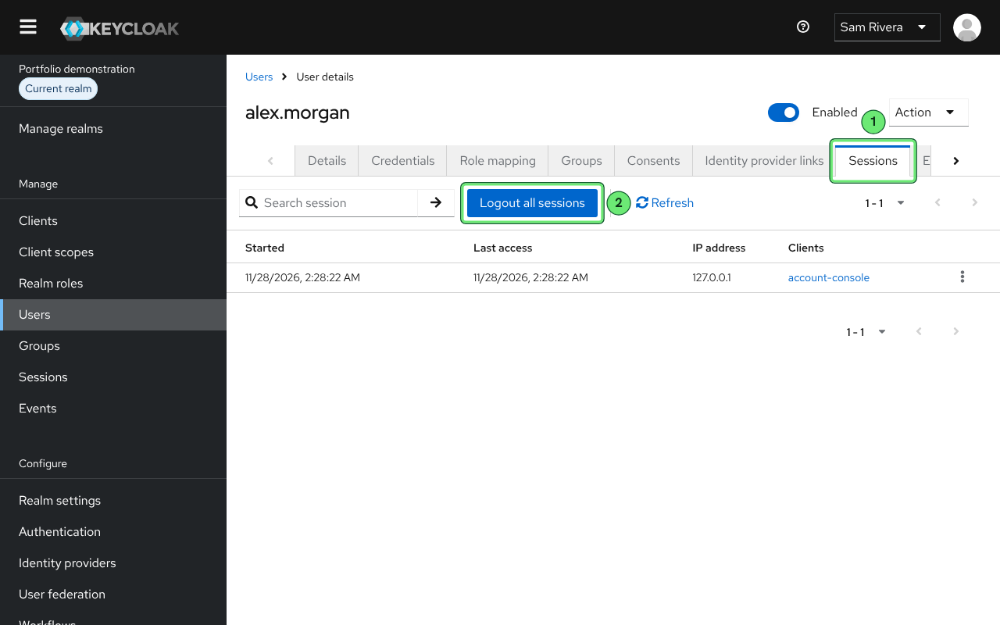
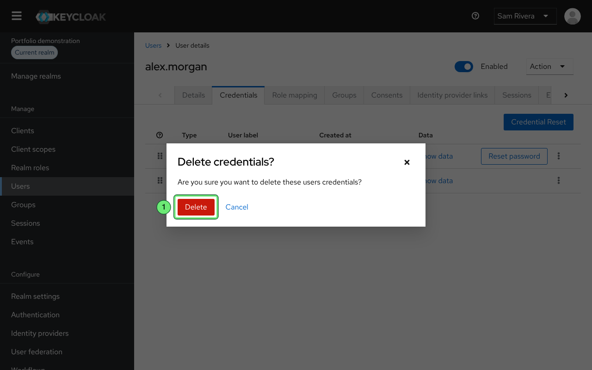
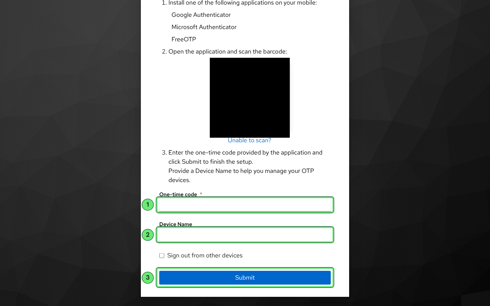
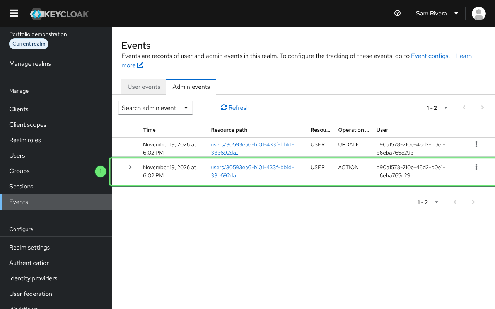

# Reset a user's OTP credential in Keycloak

When a user loses or replaces the phone that holds their authenticator app, sign the user out, delete the phone's one-time password (OTP) credential, and make the user set up a new one at their next sign-in. This resets the OTP credential only: it doesn't remove passkeys, security keys or other second factors that the user may also have.

For Keycloak administrators. Written for Keycloak 26.8.2 and checked against it. Every screen here comes from a Keycloak 26.8.2 server running on my own computer, with a test realm and test users. This is an independent guide, not official Keycloak documentation.

## Before you start

- Confirm that the request comes from the user. Use a phone number or an address the user gave before they lost the phone, not one in the request.
- Sign in to the admin console with an account that can manage the realm's users. The screenshots were taken as an administrator of the master realm.
- Make sure that the user has the new phone, with an authenticator app such as FreeOTP, Google Authenticator, or Microsoft Authenticator.
- Check that the realm uses Keycloak's default browser flow, in which the OTP step is conditional. With a custom flow, Keycloak may ask for a code at a different point, or not at all.

> **Important:** Do the steps in this order. Sign the user out first: an open session reaches **Mobile Authenticator Setup** without asking for the password. Then add the required action before you delete the credential: in the other order, the user can sign in with the password alone in between. I tested both on Keycloak 26.8.2.

## Steps

1. In the admin console, check that the user's realm is the current realm: its name is at the top of the menu. Select **Users**, search for the user, and then select their username.

   

2. On the **Sessions** tab, select **Logout all sessions**, and then select **Confirm**. The dialog says that it signs out "active subjects in this realm." On a user's **Sessions** tab, it signs out that user only. In a test with a second user, the second user's session stayed open.

   

3. On the **Details** tab, in **Required user actions**, select **Configure OTP**, and then select **Save**.

   

4. Select the **Credentials** tab, and find the **Otp** row of the lost phone: its **User label** names the device, such as *Alex's phone*. If the user has more than one **Otp** row, delete only the row of the lost phone.

   

5. In that **Otp** row, open the menu at the end of the row, and then select **Delete**.

   

6. In the **Delete credentials?** dialog, select **Delete**. Check that the **Otp** row of the lost phone no longer appears on the **Credentials** tab.

   

7. Ask the user to sign in. After the password, Keycloak shows **Mobile Authenticator Setup**. The user scans the QR code with the authenticator app on the new phone, enters the code that the app shows, names the device, and then selects **Submit**.

   

> **Note:** If the phone was stolen, or the password may be known to someone else, also select **Update Password** in step 3. The user then sets a new password before setting up the authenticator.

## Check that it worked

On the **Sessions** tab, no session is listed. On the **Credentials** tab, a new **Otp** row shows the name that the user gave the new device, with today's date.

Keycloak also keeps a record. When the realm saves admin events, **Events** > **Admin events** lists the deletion as an `ACTION` on the user's credential, and the new required action as an `UPDATE` of the user.

## Next steps

- If *Invalid authenticator code.* appears during the setup, see [When a Keycloak user can't sign in with a one-time password](/docs/keycloak/otp-troubleshooting).
- To see what the realm asks of an authenticator, such as the number of digits and how long a code lasts, see [Keycloak OTP policy](/docs/keycloak/otp-policy).
