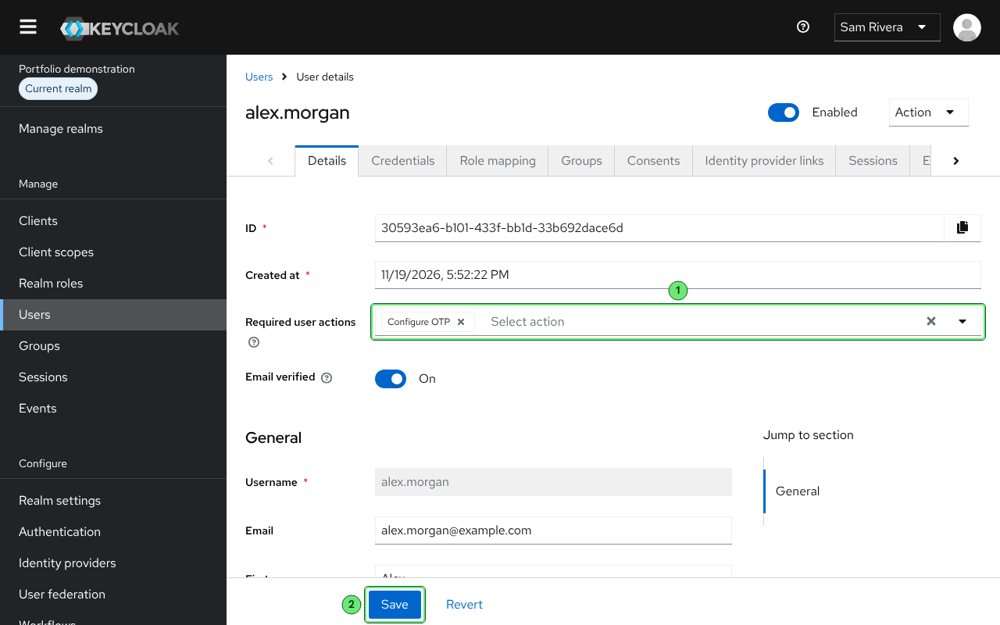

# Reset a user's one-time password in Keycloak

When a user loses or replaces the phone that holds their authenticator, delete its one-time password (OTP) credential. Then make the user set up a new one at their next sign-in.

For Keycloak administrators. Written for Keycloak 26.8.2 and checked against it. Every screen here comes from a Keycloak 26.8.2 server running on my own computer, with a test realm and test users. This is an independent guide, not official Keycloak documentation.

## Before you start

- Confirm that the request comes from the user. Use a phone number or an address the user gave before they lost the phone, not one in the request.
- Sign in to the admin console with an account that can manage the realm's users. I took the screens here as an administrator of the master realm.

## Steps

1. In the admin console, check that the user's realm is the current realm: its name is at the top of the menu. Select **Users**, search for the user, and select their username.

   

2. Select the **Credentials** tab. Find the row of type **Otp**. Its user label names the device, such as *Alex's phone*.

   

3. Open the row's menu, and then select **Delete**.

   

4. In **Delete credentials?**, select **Delete**. Keycloak reports *The credentials has been deleted successfully.*, and only the password is left on the tab.

   

   > **Caution:** Don't stop after this step. Keycloak's default sign-in flow asks for a code only from a user who has a second factor set up. Without one, the user signs in with the password alone until step 5 is done.

5. Select the **Details** tab. In **Required user actions**, select **Configure OTP**, and then select **Save**. Keycloak reports *The user has been saved*.

   

6. Ask the user to sign in. After their password, Keycloak shows **Mobile Authenticator Setup**. They scan the code with an authenticator app on the new phone, type the code the app shows, name the device, and select **Submit**.

   

## Check that it worked

On the **Credentials** tab, a new **Otp** row shows the name the user gave the new device, with today's date.

Keycloak also keeps a record. When the realm saves admin events, **Events** > **Admin events** lists the deletion as an `ACTION` on the user's credential, and the new required action as an `UPDATE` of the user.

## Next steps

- If *Invalid authenticator code.* appears during the setup, see [When a Keycloak user can't sign in with a one-time password](/docs/keycloak/otp-troubleshooting).
- To see what the realm asks of an authenticator, such as the number of digits and how long a code lasts, see [Keycloak OTP policy](/docs/keycloak/otp-policy).
