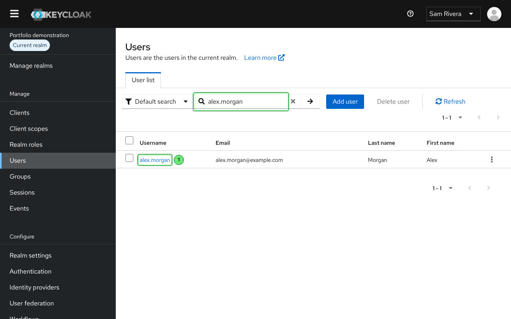
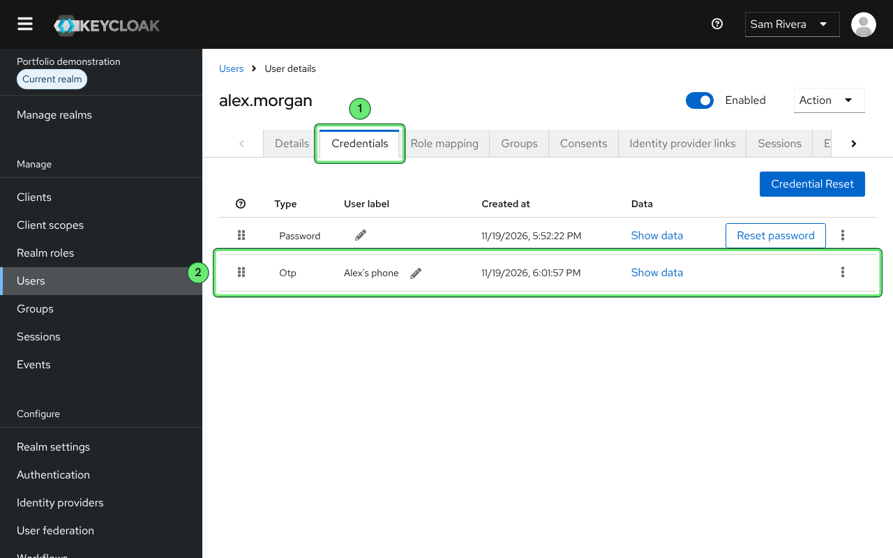
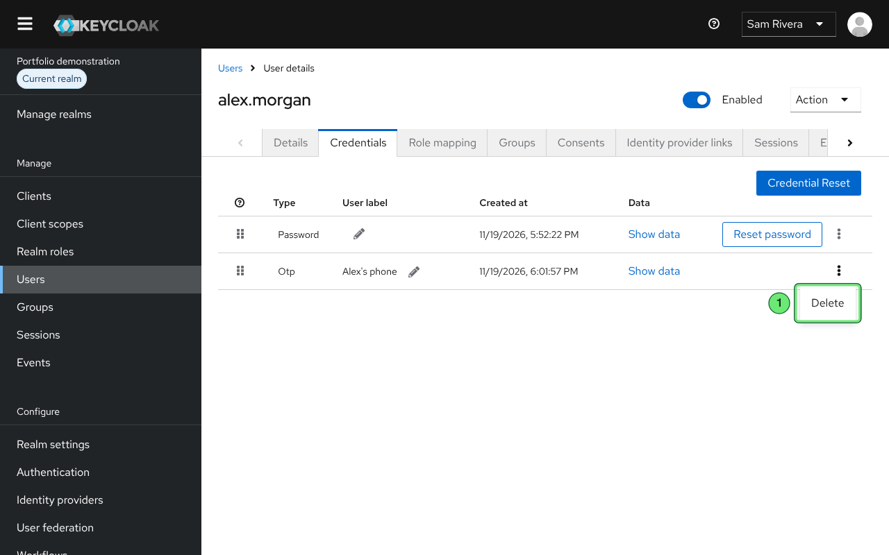
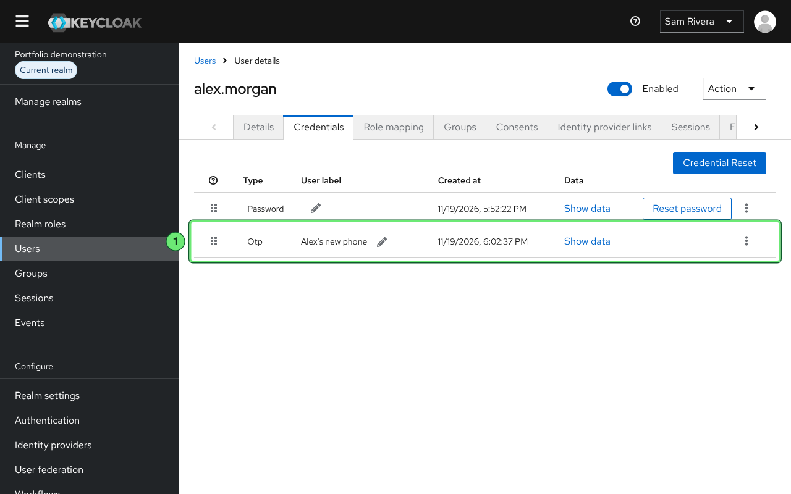

# Reset a user's one-time password in Keycloak

When a user loses or replaces the phone that holds their authenticator, delete its one-time password (OTP) credential. Then make the user set up a new one at their next sign-in.

For Keycloak administrators. Written for Keycloak 26.8.2 and checked against it. Every screen here comes from a Keycloak 26.8.2 server running on my own computer, with a test realm and test users. This is an independent guide, not official Keycloak documentation.

## Before you start

- Confirm that the request comes from the user. Use a phone number or an address the user gave before they lost the phone, not one in the request.
- Sign in to the admin console with an account that can manage the realm's users. I took the screens here as an administrator of the master realm.
- Make sure the user has their new phone, with an authenticator app such as FreeOTP, Google Authenticator, or Microsoft Authenticator.

> **Important:** Add the required action before you delete the credential. In the other order, the user can sign in with the password alone between the two actions. I tested both orders on Keycloak 26.8.2: with the required action added first, Keycloak asks for a code until the credential is deleted, and then asks the user to set up a new authenticator.

## Steps

1. In the admin console, check that the user's realm is the current realm: its name is at the top of the menu. Select **Users**, search for the user, and then select their username.

   

2. On the **Details** tab, in **Required user actions**, select **Configure OTP**, and then select **Save**.

   

3. Select the **Credentials** tab, and find the row whose type is **Otp**. Its user label names the device, such as *Alex's phone*.

   

4. In the **Otp** row, open the menu at the end of the row, and then select **Delete**.

   

5. In the **Delete credentials?** dialog, select **Delete**. Check that the **Otp** row no longer appears on the **Credentials** tab.

   

6. Ask the user to sign in. After their password, Keycloak shows **Mobile Authenticator Setup**. The user scans the QR code with the authenticator app on the new phone, enters the code that the app shows, names the device, and then selects **Submit**.

   

> **Note:** Anyone who knows the password can complete step 6 with their own phone. If the phone was stolen with the password, also select **Update Password** in step 2, so that the user sets a new password before setting up the authenticator.

## Check that it worked

On the **Credentials** tab, a new **Otp** row shows the name the user gave the new device, with today's date.

Keycloak also keeps a record. When the realm saves admin events, **Events** > **Admin events** lists the deletion as an `ACTION` on the user's credential, and the new required action as an `UPDATE` of the user.

## Next steps

- If *Invalid authenticator code.* appears during the setup, see [When a Keycloak user can't sign in with a one-time password](/docs/keycloak/otp-troubleshooting).
- To see what the realm asks of an authenticator, such as the number of digits and how long a code lasts, see [Keycloak OTP policy](/docs/keycloak/otp-policy).
