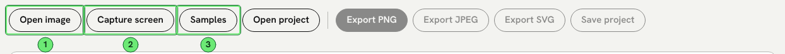
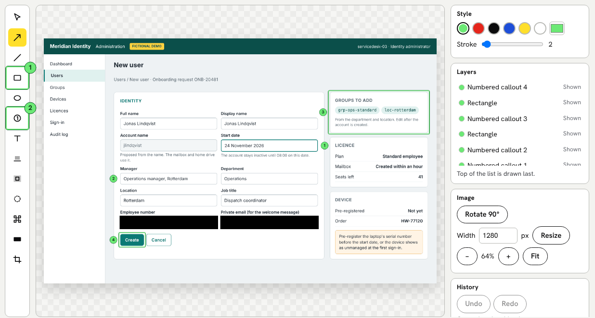
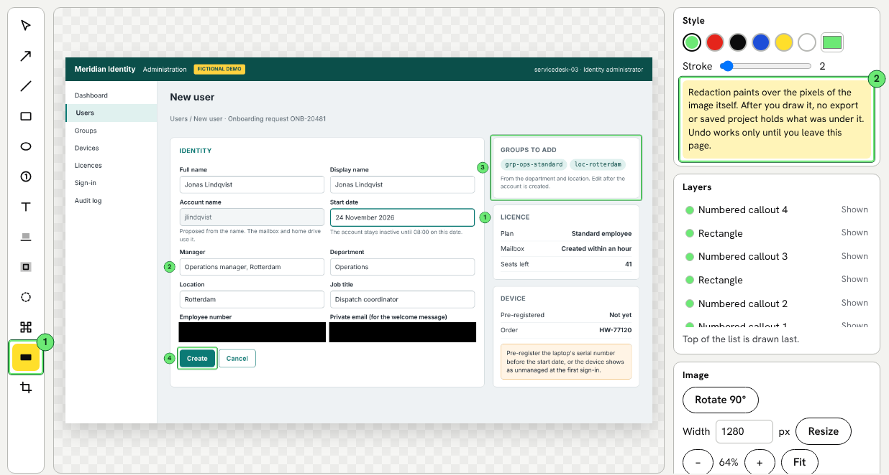
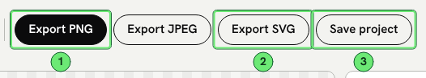

# Annotate a screenshot in the Screenshot Studio

The Screenshot Studio marks up a picture of an interface for a guide: a rectangle round the control, a number for each step, and a solid box over anything private. This guide takes one picture from opening to export, in about five minutes. The studio runs in your browser, and the picture never leaves your device.

The pictures in this guide are screenshots of the Screenshot Studio, marked up with the Screenshot Studio.

## Before you start

- You have a screenshot to mark up: a PNG, JPEG, WebP or GIF file of up to 15 MB. To practice first, use one of the samples.
- You know which control each step of your guide is about. The marks follow the order of the steps.

## Open a picture

1. Go to the [Screenshot Studio](/studio/screenshots).
2. Choose where the picture comes from:
   - To open a file, select **Open image** (1), and then choose the file. You can also paste a picture with Ctrl+V, or drop a file on the page.
   - To photograph a window, select **Capture screen** (2). Your browser asks which window to share, takes one frame, and stops sharing at once.
   - To start from an example, select **Samples** (3), and then select a card.

The picture opens in the editor: the drawing tools on the left, the picture in the middle, and its style and layers on the right.

## Mark the controls

1. In the tools on the left, select **Rectangle** (1), and then drag a box round the control that the step is about. Leave a little space between the control and the box.
2. Select **Numbered callout** (2), and then select the place beside the box where the number goes. Each callout takes the next number.
3. To move a mark or change its size, select **Select and move**, and then drag the mark. The arrow keys nudge it, and Delete removes it.

New marks are drawn in the house green with a dark edge, which reads on light and dark screens. Keep each number beside its box, not over the interface's text.

## Hide private details

1. Select **Redact (permanent)** (1).
2. Drag over each name, address, key or other detail that readers mustn't see. The area turns solid black.

The note under **Style** explains what redaction does (2): it paints over the pixels of the picture itself, so no exported file or saved project holds what was underneath. Undo works only until you leave the page.

**Blur** and **Pixelate** soften a background, but both can be reversed. Don't use them to hide a secret.

## Export the picture

- To put the picture in a guide or a help-center article, select **Export PNG** (1).
- To keep the marks as shapes that a drawing program can change, select **Export SVG** (2).
- To keep working later, select **Save project** (3). To continue, select **Open project** and choose the file.

To check the result, open the exported PNG. The marks are part of the picture, and every redacted area is solid black.

## Related

- [Screenshot standard](/standards/screenshots): the colors, sizes and placement that these pictures follow.
- [Step Guide Studio](/studio/guides): puts marked-up pictures in a numbered guide, and exports it as HTML, PDF or Markdown.
